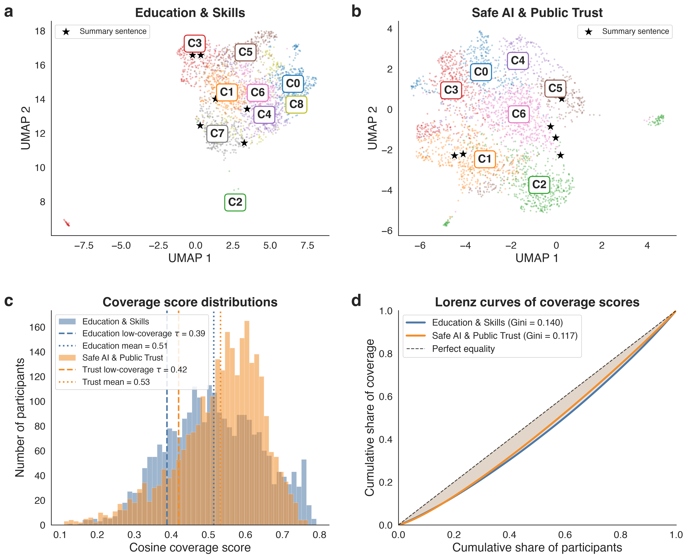
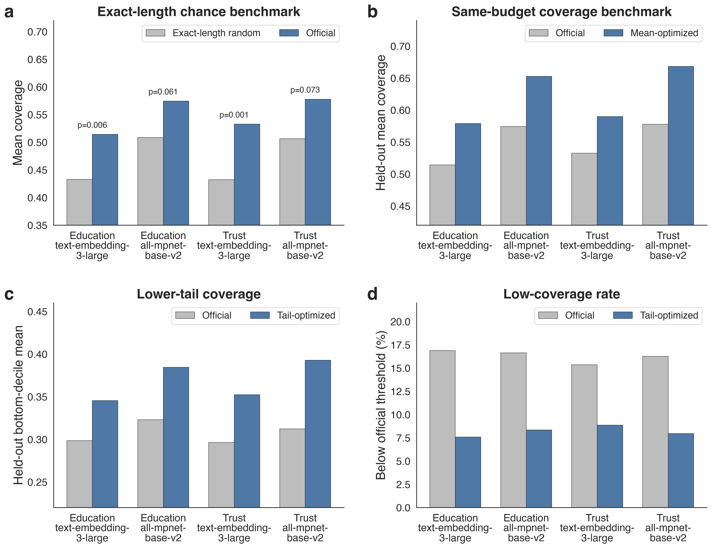
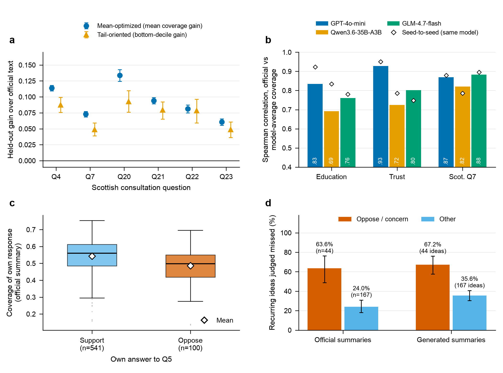

# Participatory provenance

Analysis code and results for the complete study *Participatory provenance as representational auditing for AI-mediated public consultation*, by Sachit Mahajan, ETH Zurich.

[Preprint](https://arxiv.org/abs/2604.20711) · [Citation](CITATION.cff) · [Analysis workflow](analyses/README.md) · [Changes](CHANGELOG.md)

This study asks how semantic coverage is distributed across the people who contribute to a public consultation. It pairs each response with its closest official-summary sentence, examines the lower tail of coverage, and tests whether higher coverage is feasible within the same word limits.

The study covers two themes from Canada's 2025 AI Strategy consultation and six written questions from Scotland's 2024–25 consultation on non-surgical cosmetic procedures. It also compares summaries from three language models, examines coverage by respondents' stated positions, tests the limitations of cosine similarity, and compares distribution distances.

Semantic coverage is a screening measure. A high score can persist when a sentence reverses a position or drops a condition. The paper therefore distinguishes semantic proximity from faithful representation and reports the limitations of its automated idea judgments.

## Results

### Canadian AI Strategy consultation

The Canadian analysis covers 5,253 retained records from 2,861 contributors across Education and Skills and Safe AI and Public Trust. With `text-embedding-3-large`, the official passages had mean coverage of 0.514 for Education and 0.533 for Trust. Low coverage was concentrated in groups of responses centered on criticism of educational technology and distrust of technology and oversight. [Canadian benchmark results](results/crossfit_confirmatory_summary.csv)



With the same word limits as the official passages, extractive benchmarks raised mean coverage by 0.065 for Education and 0.057 for Trust on held-out responses with `text-embedding-3-large`. The average for the lowest-scoring tenth also improved with both embedding models. The official passages exceeded the random-text benchmark on mean coverage with `text-embedding-3-large`.



### Scottish consultation on non-surgical cosmetic procedures

Across 4,169 retained answers to six questions, same-budget extractive benchmarks improved mean coverage and the average for the lowest-scoring tenth under both embedding models. None of the official passages significantly exceeded the random-text benchmark on mean coverage. For Q7, respondents who opposed a practitioner licensing requirement had lower coverage than supporters (difference −0.057, 95% bootstrap interval [−0.080, −0.036] with `text-embedding-3-large`). [Scottish benchmark results](results/reference/scotland_analysis/scotland_analysis_summary.csv) · [Stated positions](results/reference/stance_groups/results_primary_official.csv)

### Summary comparisons and checks on the coverage measure

- Coverage rankings generally agreed between official summaries and model-averaged summaries. The comparison used 27 generated summaries that met the length limits for Canadian Education, Canadian Trust and Scottish Q7. Scottish Q21 was reported separately after seven of nine attempts missed the sentence count. [Budget checks](results/reference/llm_summaries/results/budget_compliance.csv) · [Rank correlations](results/reference/llm_summaries/results/spearman.csv)
- In controlled tests using responses from both consultations, removing a passage lowered similarity more than reversing its stated position. In the exploratory Canadian idea audit, automated judges labeled opposing or concerned ideas missed more often and recognized their planted paraphrases less reliably. [Controlled tests](results/reference/provenance_diagnostics/results) · [Idea audit](results/reference/idea_audit)
- Wasserstein-1 and Wasserstein-2 gave similar rankings of the official passages and random references in both consultations. Agreement with maximum mean discrepancy varied with the kernel bandwidth. [Distance comparison results](results/reference/metric_sensitivity/results)



## Repository contents

| Path | Contents |
|---|---|
| `data/` | The two Canadian source CSV files |
| `src/` | Canadian analysis pipeline and figure scripts |
| `analyses/` | Scottish consultation pipeline, summary generation, stance analysis, idea audit, controlled diagnostics and distance comparisons |
| `results/` | Canadian reference results and input hashes |
| `results/reference/` | Aggregate study results, final generated summaries and file hashes |
| `docs/figures/` | Figures from the study |
| `scripts/` | Checks that run without API credentials |

The code and results for both consultations are available in this repository. The [analysis workflow](analyses/README.md) describes how to run the full study.

## Setup

Use Python 3.12 in a virtual environment.

```bash
git clone https://github.com/sachit27/AI-provenance.git
cd AI-provenance
python3 -m venv .venv
source .venv/bin/activate
pip install -r src/requirements-lock.txt
pip install -r analyses/requirements.txt
export OPENAI_API_KEY="your-key"
ollama pull nomic-embed-text
```

Ollama must be installed and running. Controlled generation also uses `qwen3.6:35b-a3b` and `glm-4.7-flash:Q4_K_M`. Their recorded model digests are included with the generated summaries.

Start by preparing and analyzing the Canadian consultation.

```bash
python src/run_pipeline.py --output-root src/analysis
```

The analysis scripts use `src/analysis` for the Canadian outputs and `analyses/scotland_analysis/analysis` for Scotland. The [analysis workflow](analyses/README.md) gives the download, preparation and execution order. Model calls require network access and may incur charges. Fixed analytical seeds and cached requests support repeat runs, but external services and model updates can change regenerated results.

## Reference results and checks

The [results guide](results/README.md) links to the Canadian, Scottish and comparative outputs. You can inspect these files without downloading embeddings or running models.

```bash
python scripts/check_repository.py
python scripts/check_study.py
```

GitHub Actions runs both checks. They verify file hashes, result structure, sentence budgets and Python syntax. They do not reproduce model-dependent analyses or validate automated judgments against human annotation.

## Source data and terms

The Canadian CSVs are available through the [Government of Canada Open Government Portal](https://open.canada.ca/data/en/dataset/bc8cdd54-19cf-4f62-a3d3-fa4b7371d49a) under the Open Government Licence–Canada. Their hashes are recorded in `results/input_hashes.sha256`. Official passages are transcribed in `src/config.py` from the [ISED report](https://ised-isde.canada.ca/site/ised/en/public-consultations/engagements-canadas-next-ai-strategy-summary-inputs).

The Scottish Government published 1,809 of 2,207 responses with consent. Download scripts retrieve those pages from [Citizen Space](https://consult.gov.scot/healthcare-quality-and-improvement/regulation-of-non-surgical-cosmetic-procedures/). The response texts, quotations, identifiers, caches and embeddings are generated locally. They are excluded from this release because publication on that platform does not establish a redistribution licence for respondents' words. The official [findings report](https://www.gov.scot/isbn/9781836918271) is covered by the Open Government Licence. Selected government passages and their paragraph mapping are included.

The code is licensed under MIT. Source data and government report extracts retain their source terms. Contact Sachit Mahajan at sachit.mahajan@gess.ethz.ch.
